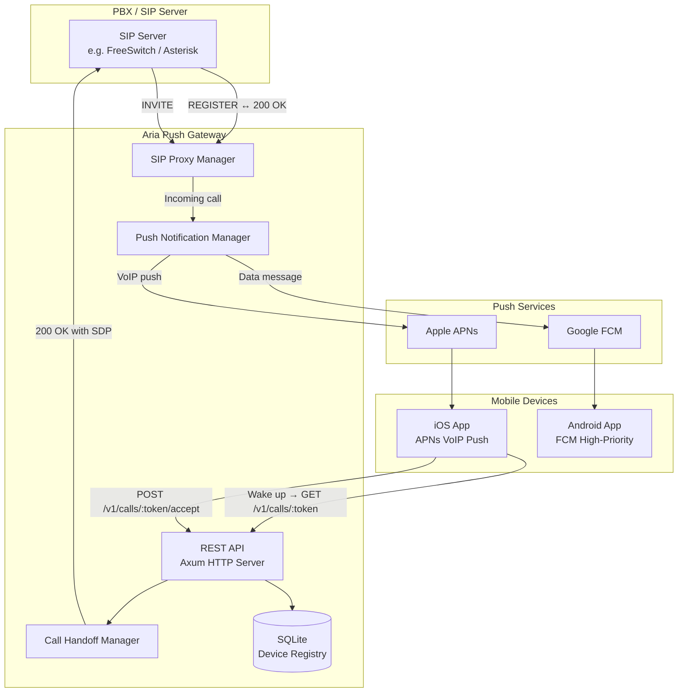
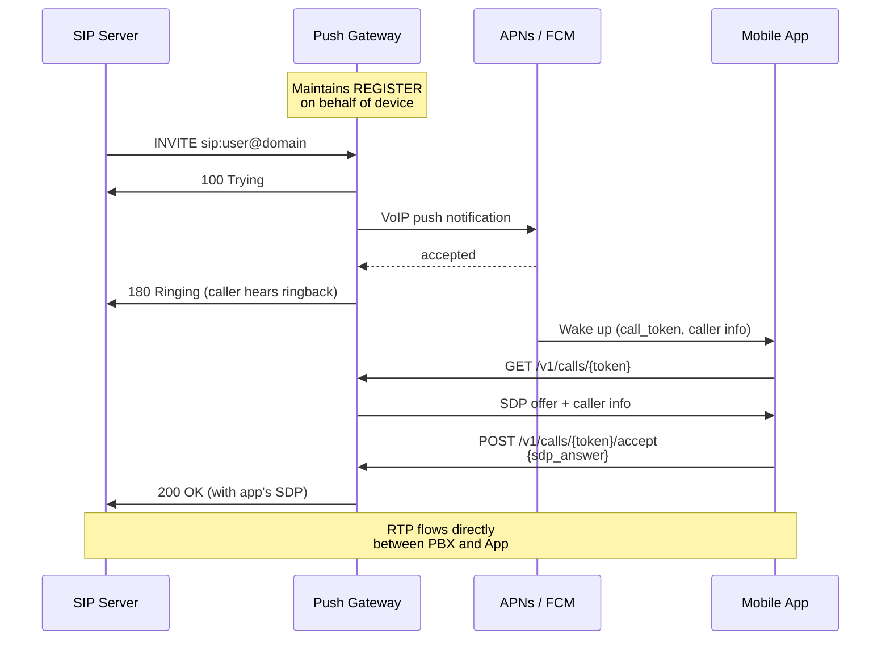

# Aria Push Gateway

SIP push gateway for Aria mobile clients. Maintains SIP registrations on behalf of mobile devices, intercepts incoming calls, and delivers VoIP push notifications via APNs (iOS) and FCM (Android).

## Architecture



## Call Flow



### Incoming call responses

The PBX's INVITE is answered without waiting on anything slow:

- **100 Trying** at once, before any lookup.
- **180 Ringing** as soon as APNs/FCM accept the push, so the caller hears
  ringback while the app wakes, not silence. It has no SDP (the app's answer
  doesn't exist yet), so the PBX plays its own ringback.
- **200 OK** with the app's SDP when the app accepts.

The 180 and every final response (200, 480, 487, 603) carry the same To tag,
so the PBX sees a single early dialog that the 200 confirms.

If the push can't be delivered, the INVITE gets **480 Temporarily
Unavailable** immediately, with a `Reason: SIP;cause=480;text="..."` header
saying why: `No push device registered`, `Push provider not configured`,
`Unsupported device platform`, `Push credentials unavailable`,
`Push rejected by provider` or `Push provider unreachable`. A push request
that takes longer than 5 s counts as unreachable. An app that doesn't
answer within 30 s gets `App did not answer the push`. There is no
fallback: the call fails.

The push runs alongside the SIP receive loop, so INVITE retransmissions and
CANCEL are answered while it is in flight. A retransmission (same Call-ID,
top Via branch and source address as the INVITE being handled) gets the
latest response again (100, 180, 200 or the final) and doesn't push the
device a second time. The same branch from another address gets 482.

Provider connections stay open between pushes (HTTP/2 keep-alive), and the
APNs JWT and FCM access token are renewed in the background well before
they expire. A push doesn't normally pay for a new connection or a round
trip to Google's token endpoint; the first push after startup still opens
the connection.

## Quick Start

### 1. Build

```bash
cargo build --release
```

The binary is at `target/release/aria-gateway`.

### 2. Configure

```bash
cp gateway.example.toml gateway.toml
# Edit gateway.toml — set auth.secret, push provider credentials, etc.
```

`auth.secret` (the JWT signing secret) must be at least 32 characters and not
a `CHANGE-ME...` placeholder. Otherwise the gateway refuses to start. A missing
`gateway.toml` falls back to a placeholder secret, so it refuses too. For
local development only, `--insecure-dev-secret` or
`ARIA_GATEWAY_INSECURE_DEV_SECRET=1` lets it start anyway with a loud warning.

Set the token-issuer key, either as `auth.token_issuer_key` in `gateway.toml`
or in the environment (the environment wins):

```bash
export TOKEN_ISSUER_KEY="$(openssl rand -hex 32)"
```

A blank `TOKEN_ISSUER_KEY` doesn't override the config value. The gateway
refuses to start if the issuer key equals `auth.secret`.
Without it the gateway still starts, logs a warning, and refuses every token
request, so no client can obtain a token. Give the same value to the Aria PBX
API as `PUSH_GATEWAY_ISSUER_KEY`.

### 3. Run

```bash
./target/release/aria-gateway --config gateway.toml
```

The gateway starts on `0.0.0.0:8080` by default. Override with `--listen`:

```bash
./target/release/aria-gateway --listen 0.0.0.0:443
```

## Transport to the PBX

A device's `sip_transport` decides how the gateway reaches its registrar:

| `sip_transport` | SRV names asked | Fallback without SRV |
|---|---|---|
| `udp` | `_sip._udp.<domain>` | A/AAAA of the domain at `sip_port`, UDP |
| `tcp` | `_sip._tcp.<domain>` | A/AAAA at `sip_port`, TCP |
| `tls` | `_sips._tcp.<domain>` | A/AAAA at `sip_port`, TLS |
| `auto` | `_sips._tcp`, then `_sip._tcp`, then `_sip._udp`; the first one published wins | A/AAAA at `sip_port`, UDP |

TLS is never traded for cleartext. `tls` only asks `_sips._tcp`. `auto` stops at
`_sips._tcp` once the domain publishes it, even when none of its targets resolve
(an error, not a fallback). A lookup failure on `_sips._tcp` is an error too.
The transport is fixed when the registration starts. A later re-resolution asks
for the same transport, and a TLS handshake failure fails over to the next TLS
target, never to UDP.

**Certificates.** TLS uses the web PKI roots (webpki-roots). An extra PEM CA
bundle can be added with `SIP_TLS_CA_FILE`; verification is never disabled. The
certificate is checked against the SRV target's host name when it is the SIP
domain or a name under it (`node1.sip.ariaroute.com` for `sip.ariaroute.com`).
Otherwise it is checked against the domain itself (RFC 5922), so an
unauthenticated SRV answer cannot point at a host that merely has some valid
certificate.

**Flows (TCP/TLS).** Each registration holds one connection to the registrar
it is on, and outgoing calls open their own. Messages are framed by
`Content-Length`. RFC 3261 retransmission timers (A/E/G, and the 2xx
retransmission until ACK) run on UDP only. On a stream a request or response is
written once, and the transaction timeouts stay the same. Each REGISTER carries
`+sip.instance`, `reg-id` and `Supported: outbound` (RFC 5626). The gateway
sends a double-CRLF keep-alive every 80-100 % of the registrar's `Flow-Timer`,
or every 25 s when there is none. If no CRLF pong arrives within 10 s, the flow
has failed. A flow failure (the connection closed or reset, or a missing pong)
re-registers at once on a new connection to the same node. If that node refuses
the connection, or drops it before answering the REGISTER, the registration
fails over.

**Failover and failback** (unchanged rules, now on every transport). A
registration moves to the next SRV target on a connect failure, an unanswered
REGISTER (8 s), 408/5xx (503 `Retry-After` honoured, 5 s–5 min), or two missed
OPTIONS health checks. From a lower-priority target it probes better ones with
OPTIONS every ~30 s (on a separate connection for TCP/TLS) and moves back to the
first one that answers. Targets of *equal* priority are load-shared by weight
and there is no failback between them. Every timer is jittered by up to 25 %.
Each device's registration moves on its own, so a node outage moves every
registration it held without unregistering any device.

**PBX settings** for TLS from the gateway (aria-cloud-pbx `aria-sip-proxy`):
the gateway opens one stream per device plus one per outgoing call, all from
the gateway's IP. Raise `SIP_STREAM_MAX_PER_IP` (default 32) above the
number of devices plus concurrent calls. List the gateway's public IP in
`PUSH_GATEWAY_SIP_SOURCES` on every node.

## Docker

Build from the `5060/` parent directory (the gateway depends on the sibling `aria-sip-core` crate):

```bash
cd /path/to/5060
docker build -f push-gateway/Dockerfile -t aria-gateway .
```

Run:

```bash
docker run -d \
  -p 8080:8080 \
  -v /path/to/data:/data \
  --name aria-gateway \
  aria-gateway
```

Mount your `gateway.toml`, APNs `.p8` key, and FCM service account JSON into `/data`.

## API Reference

Every endpoint except `/v1/auth/token` and `/health` requires
`Authorization: Bearer <token>`; a missing, malformed, expired or wrongly
signed token gets `401`.

A request body that is not valid JSON, has the wrong content type, or is
missing required fields gets `400` on every route. On call routes the
ownership check runs first, so another user's token is `404` whatever the
body says.

### Ownership

A token's subject (`sub`, the `user_id` it was minted for) owns:

- the devices it registered (`POST /v1/devices` stores the subject as the
  device's `user_id`);
- incoming calls delivered to those devices;
- outgoing calls it placed with `POST /v1/calls`.

Device and call routes act only on resources the caller owns. A device or call
that belongs to someone else is answered exactly like one that doesn't exist —
`404` — so IDs and call tokens can't be probed. The one exception is
`GET /v1/calls/{token}/status`, which never answers `404`: clients treat
`{"status": "unknown"}` as "the call is gone", so another user's call reports
`unknown`, the same as an unknown token.

### Auth

| Method | Path | Description |
|--------|------|-------------|
| `POST` | `/v1/auth/token` | Mint a JWT for a user (trusted backend only) |

Only the Aria PBX API calls this endpoint; mobile apps get their token from
the PBX API, never from the gateway directly.

**Body:** `{"user_id": "<extension id>", "api_key": "<TOKEN_ISSUER_KEY>"}`

**Response:** `{"token": "<jwt>", "expires_in": 2592000}` — an HS256 JWT with
`sub` = `user_id`, valid for `auth.token_expiry_secs`.

| Status | Meaning |
|--------|---------|
| `200` | Token issued |
| `400` | Malformed JSON, or `user_id` missing or blank |
| `401` | `api_key` missing, empty, `"auto"`, or not equal to `TOKEN_ISSUER_KEY` (compared in constant time) |
| `503` | No `TOKEN_ISSUER_KEY` configured: token minting is disabled |

The JWT signing secret (`auth.secret`) is never accepted as `api_key`.

### Devices

| Method | Path | Description |
|--------|------|-------------|
| `POST` | `/v1/devices` | Register a device for push |
| `GET` | `/v1/devices/{id}` | Get device + SIP registration status |
| `DELETE` | `/v1/devices/{id}` | Unregister device |
| `POST` | `/v1/devices/{id}/heartbeat` | Force a fresh SIP REGISTER after a network change |

Fields that end up in SIP messages are validated, and anything else gets
`400`:
- `sip_username`: URI user characters only;
- `sip_domain` and `sip_registrar`: hostname or IP, no port or parameters;
- `sip_auth_username`: a user, optionally `user@host`;
- `sip_transport`: `udp`, `tcp`, `tls` or `auto` (see [Transport to the PBX](#transport-to-the-pbx));
- `sip_display_name` and `sip_password`: no control characters;
- `platform`: `ios` or `android`.

The display name is always sent as an escaped quoted string.

Registering a device deactivates the caller's own earlier devices with the
same `sip_username` or the same `push_token`, and ends their SIP registrations
(an `Expires: 0` REGISTER) and push entries. The PBX therefore never holds two
bindings for one phone, which it would fork incoming calls to. That happens, for
example, when a phone re-registers after failing back from another gateway
instance. It never touches another user's
devices: if another user has an active device with the same push token, both
registrations are kept and a warning is logged.

`GET`, `DELETE` and `heartbeat` answer `404` for a device that doesn't exist
or isn't the caller's. `DELETE` answers `204` on success; `heartbeat` answers
`204`, `410` for an unregistered (inactive) device, or `502` if the SIP
re-registration fails.

**Register body:**
```json
{
  "platform": "ios",
  "push_token": "<apns-device-token>",
  "bundle_id": "com.example.aria",
  "alert_token": "<regular-apns-device-token>",
  "sip_username": "alice",
  "sip_password": "secret",
  "sip_domain": "sip.example.com",
  "sip_registrar": "pbx.example.com",
  "sip_transport": "udp",
  "sip_port": 5060,
  "sip_display_name": "Alice"
}
```

`alert_token` is optional: the token for ordinary notifications (text
messages). On iOS it is the regular APNs device token, which is not the PushKit
token in `push_token`; an iOS device without one gets no message alerts. On
Android the FCM `push_token` serves both.

### Notifications

| Method | Path | Description |
|--------|------|-------------|
| `POST` | `/v1/notify` | Send an alert to every active device of a user (trusted backend only) |

Like `/v1/auth/token`, it takes `api_key` (the `TOKEN_ISSUER_KEY`) in the
body and needs no bearer token.

**Body:** `{"api_key", "user_id", "kind": "message", "title", "body"?, "thread_id"?, "data"?: {string: string}}`

The alert is an ordinary notification (APNs `alert`, FCM notification message),
never a VoIP push. `data` is delivered beside it (at most 20 entries; `aps` is
reserved). `body` is optional so a backend can leave message text out of
Apple's and Google's systems.

**Response:** `{"sent", "failed", "skipped"}`: devices the provider accepted,
devices it refused or could not be reached for, and devices that cannot take an
alert (iOS without an `alert_token`). `200` whatever the counts.

### Call Signaling

| Method | Path | Description |
|--------|------|-------------|
| `POST` | `/v1/calls` | Initiate outgoing call (gateway sends INVITE) |
| `POST` | `/v1/calls/cancel` | Cancel a still-ringing outgoing call by its `client_ref` |
| `GET` | `/v1/calls/{token}` | Get incoming call offer (SDP + caller info) |
| `POST` | `/v1/calls/{token}/accept` | Accept call with SDP answer (`502` if the 200 OK can't be sent, `409` if a call with the same Call-ID is already active) |
| `POST` | `/v1/calls/{token}/reject` | Reject call (sends 603 to PBX) |
| `POST` | `/v1/calls/{token}/hangup` | Hang up active call (sends BYE to PBX) |
| `POST` | `/v1/calls/{token}/transfer` | Blind- or attended-transfer an active call (sends REFER to PBX) |
| `POST` | `/v1/calls/{token}/media` | Move an answered call's media to the phone's new address (re-INVITE; see below) |
| `GET` | `/v1/calls/{token}/status` | Poll call state: `pending`, `active`, `ended` (with `reason`) or `unknown` |

Offer, accept, reject, hangup and transfer answer `404` when the token is
unknown, has expired, or belongs to another user's call. `/status` answers
`200 {"status": "unknown"}` in those cases (see [Ownership](#ownership)).

**Outgoing call body:**
```json
{
  "destination_uri": "sip:bob@example.com",
  "sdp_offer": "<SDP>",
  "sip_username": "alice",
  "sip_domain": "sip.example.com"
}
```

`destination_uri` may be a number or extension (dialled in the account's
domain), `user@host`, or a `sip:`/`sips:` URI. It is validated like a
transfer target, so CR/LF, `<>"`, whitespace, `?` headers and `method=` are
rejected with `400 {"error":"invalid_destination"}`.

`sip_username` + `sip_domain` (domain case-insensitive) select the SIP
account. It must belong to an **active device the caller registered**,
otherwise `404`. The call is placed with that device's stored credentials,
registrar, port and display name. Older clients also send `sip_password`,
`sip_registrar`, `sip_transport`, `sip_port`, `sip_auth_username` and
`sip_display_name`. Those fields are still accepted but ignored.

`POST /v1/calls` blocks until the call is answered or fails. To be able to
cancel it while it rings, include an optional `"client_ref"` (1–64 characters
of `A-Z a-z 0-9 _ -`). The gateway tracks the pending INVITE under the caller
and that ref until a final response arrives.

| Status | Meaning |
|--------|---------|
| `200` | Answered: `{"call_token", "sdp_answer"}` |
| `400` | Malformed body, or `{"error":"invalid_client_ref"}` |
| `404` | The caller has no active device for `sip_username` + `sip_domain` |
| `409` | `{"error":"cancelled"}`: cancelled via `/v1/calls/cancel` |
| `409` | `{"error":"client_ref_in_use"}`: the caller already has a pending call with this `client_ref` |
| `502` | `{"error":"media_not_acceptable","sip_status":488}`: the PBX answered `488` or `606` (it will not take the offered media, e.g. an `RTP/SAVP` offer to a PBX without SRTP; the app may retry with `RTP/AVP`) |
| `502` | `{"error":"call_failed","sip_status":N}`: any other final non-2xx `N` from the PBX (e.g. `486`, `403`) |
| `502` | No body: the INVITE timed out (30 s), the PBX was unreachable, or the INVITE could not be sent |

**Cancel body:** `{"client_ref": "<ref>"}`

| Status | Meaning |
|--------|---------|
| `202` | The caller's pending INVITE with this ref is being cancelled. Repeating the request while that call is still pending also returns `202`. |
| `400` | Malformed body or invalid `client_ref` |
| `404` | No such pending call: unknown ref, another user's ref, or the call was already answered or ended |

On cancel the gateway sends a CANCEL matching the pending INVITE (same
Request-URI, Via branch, Route, From, To, Call-ID and CSeq number) and
retransmits it until the PBX answers. It ACKs the INVITE's final response
(normally `487`). If a `200 OK` crosses the CANCEL, the gateway ACKs it and
immediately sends BYE, so a cancelled call never stays up. Either way the
blocked `POST /v1/calls` returns `409 {"error":"cancelled"}`. The ref is
released on every outcome and can be reused.

**Response:** `{"call_token": "<token>", "sdp_answer": "<SDP>"}`

**Accept body:** `{"sdp_answer": "<SDP>"}`

**Transfer body:** `{"target": "1002"}` or `{"target": "sip:1002@pbx.example.com"}`

Any active call can be transferred, whether the PBX sent it to the phone or
the phone placed it: the REFER goes in-dialog on the call's PBX dialog, as the
UAS or the UAC of that dialog. (The PBX must support REFER from either side of
a call; older Aria PBX releases act only on REFER from the answering side.)

A bare number/extension (letters, digits and `+ * # . - _`) is sent as
`Refer-To: <sip:<target>@<account SIP domain>>`; a `sip:`/`sips:` URI is sent
as-is. Targets containing whitespace, control characters, `<`, `>`, `"`, `,`,
`?`, a `method=` parameter or unsafe percent-escapes are rejected.

| Status | Meaning |
|--------|---------|
| `202` | PBX accepted the REFER. The call then ends through the normal flow: when the PBX reports the transfer succeeded (NOTIFY with `SIP/2.0 200`) the gateway sends BYE, or the PBX sends BYE itself. `/status` then reports `{"status": "ended", "reason": "transferred"}`. |
| `400` | Missing, empty or invalid `target`, or a malformed JSON body |
| `401` | Missing or invalid bearer token |
| `404` | Unknown token, another user's call, or the call is not active (e.g. still ringing) |
| `409` | A transfer of this call is already in progress (REFER outstanding, or accepted and not yet resolved) |
| `502` | PBX rejected the REFER (non-2xx final response, including a second auth challenge) or it could not be sent |
| `504` | No final response from the PBX within 8 seconds. The PBX may still have acted on the REFER, so the call stays claimed (`409` for another transfer) and `/status` reports `"transfer":"pending"` until a NOTIFY or BYE settles it, or `failed`/`408` after 30 s. |

After a `202` (or a `504`, or a request dropped after the REFER went out),
`GET /v1/calls/{token}/status` on the still-active call reports
the outcome:

| Body | Meaning |
|------|---------|
| `{"status":"active","transfer":"pending"}` | REFER accepted, outcome not known yet |
| `{"status":"active","transfer":"failed","transfer_code":486}` | Transfer failed. The code is the NOTIFY's sipfrag status, or `408` if the refer subscription ended without a final status or no NOTIFY arrived within 30 s. The call stays up and can be transferred again. |
| `{"status":"ended","reason":"transferred"}` | Transfer succeeded |

`transfer` and `transfer_code` are omitted when no transfer has been accepted
on the call. A new accepted transfer resets the state to `pending`.

If the PBX challenges the REFER (`401`/`407`), the gateway resends it once
with digest credentials from the SIP account that carried the call. After a
failed transfer (`502`, or `"transfer":"failed"` in `/status`) the call stays
up and can be transferred again.

**Attended (consultative) transfer body:** `{"replaces": "<other call token>"}`

Joins the far ends of two of the caller's active calls and drops the phone
from both: typically the call being transferred and a consultation call the
user placed to the target. `target` is ignored when `replaces` is present.

Each call may be one the phone received or one it placed, in any
combination. The gateway sends the REFER on the dialog of the call in the
path (the transferred call), with a `Replaces` naming the dialog of the call
in `replaces` (the consultation call):

```
Refer-To: <sip:<consultation remote URI>?Replaces=<consultation Call-ID>%3Bto-tag%3D<PBX tag>%3Bfrom-tag%3D<gateway tag>>
```

Per RFC 3891 the tags are given as the recipient of the `INVITE` with
`Replaces` (the PBX) sees the consultation dialog: `to-tag` is the PBX's own
tag on it and `from-tag` the gateway's, whichever side sent that dialog's
INVITE. Both calls must be on the same PBX node and reach it from the same
gateway source address. The Call-ID and tags are percent-encoded (everything except
`A-Z a-z 0-9 - . _ ~`). `Referred-By`, digest retry and the 30 s NOTIFY
watchdog work as for blind transfer.

| Status | Meaning |
|--------|---------|
| `202` | PBX accepted the REFER. Both calls report `"transfer":"pending"` in `/status` |
| `400` | Malformed body, or `{"error":"same_call"}`: both tokens name the same call |
| `404` | Either token is unknown or belongs to another user's call |
| `409` | `{"error":"call_not_established"}`: either call is still ringing or already ended |
| `409` | (no body) A transfer of either call is already in progress. Both calls are claimed until the transfer resolves |
| `502` / `504` | As for blind transfer. On `502` both calls stay up and are released; `/status` is unchanged |

Outcome, reported on **both** calls' `/status`:

- **Success.** On the NOTIFY `SIP/2.0 200` the gateway sends BYE on both
  legs. If the PBX's own BYEs arrive first, they are answered instead. Either
  way both calls report `{"status":"ended","reason":"transferred"}`.
- **Failure.** A failure NOTIFY (code `N`), a subscription terminated without
  success, or no NOTIFY within 30 s (`408`) leaves both calls up. Both report
  `{"status":"active","transfer":"failed","transfer_code":N}`, and both can be
  transferred again.
- **Abandoned.** If the app hangs up the transferred call while the transfer is
  pending, the consultation call is released with `"transfer":"failed"`,
  `"transfer_code":487`.

### Media update (network change)

`POST /v1/calls/{token}/media` with `{"sdp": "<the phone's new SDP offer>"}`
moves an answered call's media to a new address, for example after the phone
switched from Wi-Fi to cellular. The gateway sends the PBX an in-dialog
re-INVITE carrying the SDP. The `o=` line is the call's previous one with the
session version incremented (RFC 3264). The answer is
`200 {"sdp_answer": "<PBX's SDP>"}`.

| Status | Meaning |
|--------|---------|
| `200` | The PBX accepted. The call's media is now on the new address |
| `400` | Missing body, or an SDP that is not `v=0` with a `c=` address and an `m=audio` port, contains control characters, or is over 8 KB |
| `404` | Unknown token, another user's call, or a call that is not answered |
| `409` | Another media update of this call is in progress |
| `502` | The PBX refused (the refusal is ACKed). The call stays up on its previous media. Body `{"error":"media_not_acceptable","sip_status":488}` for `488`/`606`, otherwise `{"error":"media_update_rejected","sip_status":N}` (e.g. `491`) |
| `502` | No body: the re-INVITE could not be sent |
| `504` | No final response within 8 s |

The 2xx is ACKed, and the ACK is sent again if the PBX repeats the 2xx. Over UDP
the INVITE is retransmitted until a final response. The PBX's media relay must
honour the new address: aria-cloud-pbx re-points the relay leg on such a
re-INVITE only from the release that implements it (see the release notes).

### SRTP (SDES)

The gateway carries SDP between the app and the PBX unchanged, so an
`RTP/SAVP` offer or answer with SDES `a=crypto:` lines (RFC 4568) reaches the
other side byte for byte and SRTP runs end to end between the phone and the
PBX. Media goes directly between the phone and the PBX's media address; the
optional gateway RTP relay (not enabled for calls today) rewrites only the
`c=`/`o=` address and the `m=audio` port, and forwards datagrams (SRTP, and
SRTCP when `a=rtcp-mux` is used) without parsing them. It has no RTP+1 RTCP
port, so without `rtcp-mux` RTCP is not relayed.

The SDES keys travel in the SIP signalling. When an SDP with `a=crypto:` is
sent to or received from the PBX over UDP or TCP the gateway logs a warning,
since the keys are then readable on that hop: use `sip_transport: "tls"` to
keep them confidential.

### Health

| Method | Path | Description |
|--------|------|-------------|
| `GET` | `/health` | Health check (returns `ok`) |

## Self-Hosting

The gateway is designed to be self-hosted. Requirements:

- **Network:** The gateway needs UDP, TCP or TLS connectivity to your SIP server for REGISTER/INVITE traffic (see [Transport to the PBX](#transport-to-the-pbx)). It also needs outbound HTTPS to APNs/FCM.
- **SIP sources:** A registration accepts SIP only from the IPs its registrar resolves to, and an outgoing call only from the IPs of the server it dialled, on any source port. Anything else is dropped and logged. Spoofed in-dialog requests from an accepted IP are still refused: they must match the dialog's Call-ID and both tags and arrive on the socket that owns the dialog.
  - **Floating IPs and multi-node PBXs:** a PBX bound to `0.0.0.0` behind a floating/reserved IP (e.g. a DigitalOcean reserved IP) sends from the droplet's own address, not the resolved one. A host with several addresses, or several proxy nodes (NOTIFY/MESSAGE from another node), behaves the same way. List those source addresses in `TRUSTED_SIP_SOURCES` (env) or `[sip] trusted_sources` (gateway.toml) as comma-separated IPs/CIDRs, e.g. `TRUSTED_SIP_SOURCES="10.10.0.0/16,203.0.113.7"`. A blank env value falls back to the config, and an invalid entry stops startup. Without this, those deployments drop every incoming call.
- **Database:** Uses SQLite (no external database needed). The file is created automatically.
- **Push credentials:** You need an APNs auth key (`.p8` file) for iOS and/or a Firebase service account JSON for Android.
- **Token issuer key:** Set `TOKEN_ISSUER_KEY` (or `auth.token_issuer_key`) and share it only with the Aria PBX API. Keep it distinct from `auth.secret`.
- **TLS:** Put the gateway behind a reverse proxy (nginx, Caddy, Traefik) for HTTPS termination. The mobile app connects over HTTPS.
- **DNS:** Point a subdomain (e.g., `gateway.example.com`) at your server.

### Minimum system requirements

- 1 vCPU, 256 MB RAM (handles hundreds of concurrent registrations)
- ~10 MB disk for the binary + database
- Linux, macOS, or any platform Rust targets

## Shared Code

This gateway uses `aria-sip-core` for SIP digest authentication and message parsing — the same crate used by the Aria desktop softphone. This ensures protocol compatibility across all Aria clients.

## License

Proprietary — 5060 Solutions
