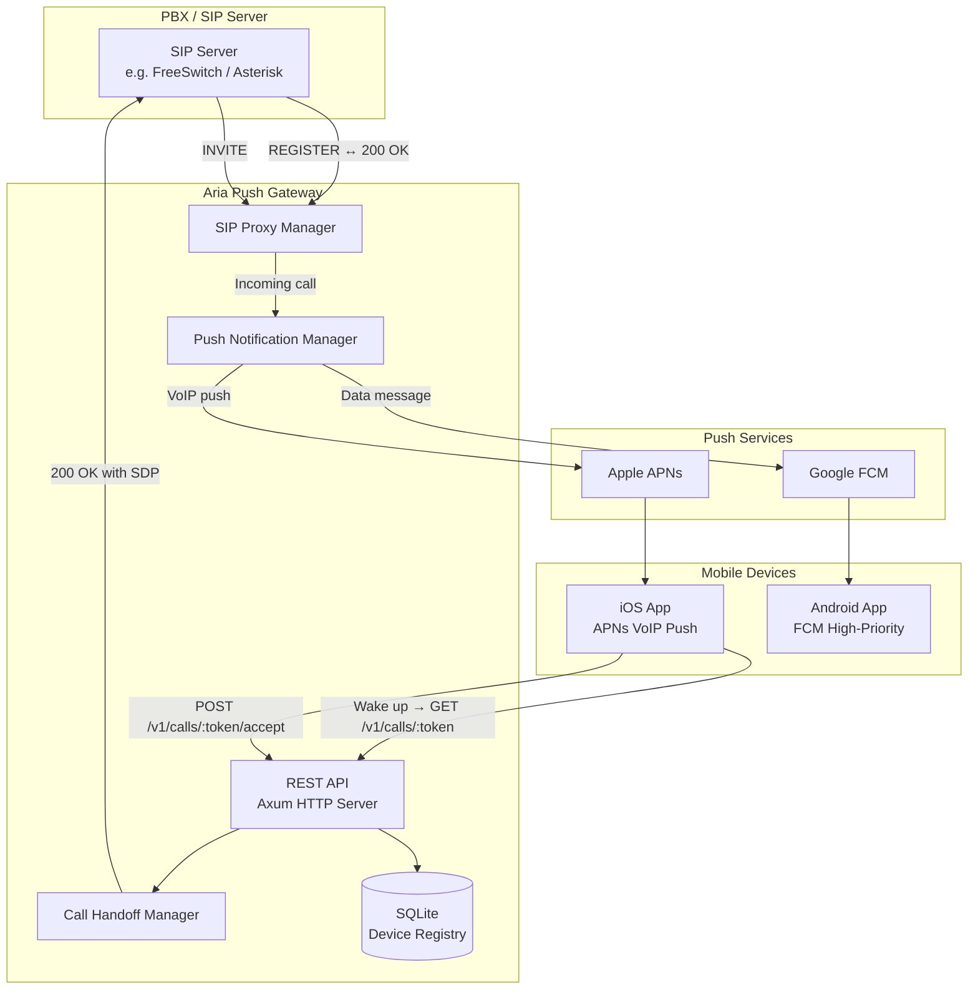
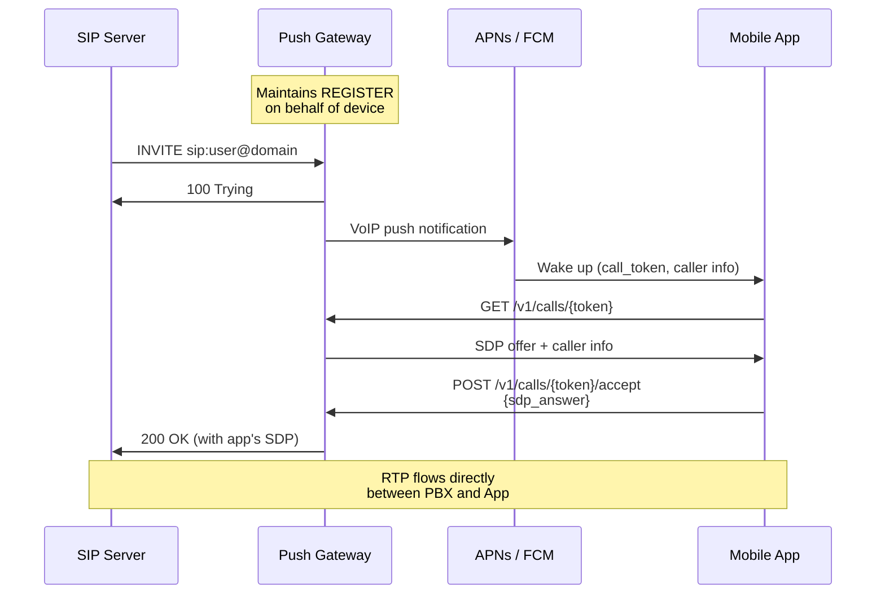

# Aria Push Gateway

SIP push gateway for Aria mobile clients. Maintains SIP registrations on behalf of mobile devices, intercepts incoming calls, and delivers VoIP push notifications via APNs (iOS) and FCM (Android).

## Architecture



## Call Flow



## Quick Start

### 1. Build

```bash
cargo build --release
```

The binary is at `target/release/aria-gateway`.

### 2. Configure

```bash
cp gateway.example.toml gateway.toml
# Edit gateway.toml — set auth.secret, push provider credentials, etc.
```

Set the token-issuer key, either as `auth.token_issuer_key` in `gateway.toml`
or in the environment (the environment wins):

```bash
export TOKEN_ISSUER_KEY="$(openssl rand -hex 32)"
```

Without it the gateway still starts, logs a warning, and refuses every token
request, so no client can obtain a token. Give the same value to the Aria PBX
API as `PUSH_GATEWAY_ISSUER_KEY`.

### 3. Run

```bash
./target/release/aria-gateway --config gateway.toml
```

The gateway starts on `0.0.0.0:8080` by default. Override with `--listen`:

```bash
./target/release/aria-gateway --listen 0.0.0.0:443
```

## Docker

Build from the `5060/` parent directory (the gateway depends on the sibling `aria-sip-core` crate):

```bash
cd /path/to/5060
docker build -f push-gateway/Dockerfile -t aria-gateway .
```

Run:

```bash
docker run -d \
  -p 8080:8080 \
  -v /path/to/data:/data \
  --name aria-gateway \
  aria-gateway
```

Mount your `gateway.toml`, APNs `.p8` key, and FCM service account JSON into `/data`.

## API Reference

Every endpoint except `/v1/auth/token` and `/health` requires
`Authorization: Bearer <token>`; a missing, malformed, expired or wrongly
signed token gets `401`.

### Ownership

A token's subject (`sub`, the `user_id` it was minted for) owns:

- the devices it registered (`POST /v1/devices` stores the subject as the
  device's `user_id`);
- incoming calls delivered to those devices;
- outgoing calls it placed with `POST /v1/calls`.

Device and call routes act only on resources the caller owns. A device or call
that belongs to someone else is answered exactly like one that doesn't exist —
`404` — so IDs and call tokens can't be probed. The one exception is
`GET /v1/calls/{token}/status`, which never answers `404`: clients treat
`{"status": "unknown"}` as "the call is gone", so another user's call reports
`unknown`, the same as an unknown token.

### Auth

| Method | Path | Description |
|--------|------|-------------|
| `POST` | `/v1/auth/token` | Mint a JWT for a user (trusted backend only) |

Only the Aria PBX API calls this endpoint; mobile apps get their token from
the PBX API, never from the gateway directly.

**Body:** `{"user_id": "<extension id>", "api_key": "<TOKEN_ISSUER_KEY>"}`

**Response:** `{"token": "<jwt>", "expires_in": 2592000}` — an HS256 JWT with
`sub` = `user_id`, valid for `auth.token_expiry_secs`.

| Status | Meaning |
|--------|---------|
| `200` | Token issued |
| `400` | Malformed JSON, or `user_id` missing or blank |
| `401` | `api_key` missing, empty, `"auto"`, or not equal to `TOKEN_ISSUER_KEY` (compared in constant time) |
| `503` | No `TOKEN_ISSUER_KEY` configured: token minting is disabled |

The JWT signing secret (`auth.secret`) is never accepted as `api_key`.

### Devices

| Method | Path | Description |
|--------|------|-------------|
| `POST` | `/v1/devices` | Register a device for push |
| `GET` | `/v1/devices/{id}` | Get device + SIP registration status |
| `DELETE` | `/v1/devices/{id}` | Unregister device |
| `POST` | `/v1/devices/{id}/heartbeat` | Force a fresh SIP REGISTER after a network change |

`GET`, `DELETE` and `heartbeat` answer `404` for a device that doesn't exist
or isn't the caller's. `DELETE` answers `204` on success; `heartbeat` answers
`204`, `410` for an unregistered (inactive) device, or `502` if the SIP
re-registration fails.

**Register body:**
```json
{
  "platform": "ios",
  "push_token": "<apns-device-token>",
  "bundle_id": "com.example.aria",
  "sip_username": "alice",
  "sip_password": "secret",
  "sip_domain": "sip.example.com",
  "sip_registrar": "pbx.example.com",
  "sip_transport": "udp",
  "sip_port": 5060,
  "sip_display_name": "Alice"
}
```

### Call Signaling

| Method | Path | Description |
|--------|------|-------------|
| `POST` | `/v1/calls` | Initiate outgoing call (gateway sends INVITE) |
| `GET` | `/v1/calls/{token}` | Get incoming call offer (SDP + caller info) |
| `POST` | `/v1/calls/{token}/accept` | Accept call with SDP answer |
| `POST` | `/v1/calls/{token}/reject` | Reject call (sends 603 to PBX) |
| `POST` | `/v1/calls/{token}/hangup` | Hang up active call (sends BYE to PBX) |
| `POST` | `/v1/calls/{token}/transfer` | Blind-transfer active call (sends REFER to PBX) |
| `GET` | `/v1/calls/{token}/status` | Poll call state: `pending`, `active`, `ended` (with `reason`) or `unknown` |

Offer, accept, reject, hangup and transfer answer `404` when the token is
unknown, has expired, or belongs to another user's call. `/status` answers
`200 {"status": "unknown"}` in those cases (see [Ownership](#ownership)).

**Outgoing call body:**
```json
{
  "destination_uri": "sip:bob@example.com",
  "sdp_offer": "<SDP>",
  "sip_username": "alice",
  "sip_password": "secret",
  "sip_domain": "sip.example.com",
  "sip_display_name": "Alice"
}
```

**Response:** `{"call_token": "<token>", "sdp_answer": "<SDP>"}`

**Accept body:** `{"sdp_answer": "<SDP>"}`

**Transfer body:** `{"target": "1002"}` or `{"target": "sip:1002@pbx.example.com"}`

A bare number/extension (letters, digits and `+ * # . - _`) is sent as
`Refer-To: <sip:<target>@<account SIP domain>>`; a `sip:`/`sips:` URI is sent
as-is. Targets containing whitespace, control characters, `<`, `>`, `"`, `,`,
`?`, a `method=` parameter or unsafe percent-escapes are rejected.

| Status | Meaning |
|--------|---------|
| `202` | PBX accepted the REFER. The call then ends through the normal flow: when the PBX reports the transfer succeeded (NOTIFY with `SIP/2.0 200`) the gateway sends BYE, or the PBX sends BYE itself. `/status` then reports `{"status": "ended", "reason": "transferred"}`. |
| `400` | Missing, empty or invalid `target`, or a malformed JSON body |
| `401` | Missing or invalid bearer token |
| `404` | Unknown token, another user's call, or the call is not active (e.g. still ringing) |
| `409` | A transfer of this call is already in progress (REFER outstanding, or accepted and not yet resolved) |
| `502` | PBX rejected the REFER (non-2xx final response, including a second auth challenge) or it could not be sent |
| `504` | No final response from the PBX within 8 seconds |

If the PBX challenges the REFER (`401`/`407`), the gateway resends it once
with digest credentials from the SIP account that carried the call. After a
failed transfer (`502`/`504`, or a NOTIFY reporting the target failed) the
call stays up and can be transferred again.

Only blind (unattended) transfer is supported.

### Health

| Method | Path | Description |
|--------|------|-------------|
| `GET` | `/health` | Health check (returns `ok`) |

## Self-Hosting

The gateway is designed to be self-hosted. Requirements:

- **Network:** The gateway needs UDP connectivity to your SIP server for REGISTER/INVITE traffic. It also needs outbound HTTPS to APNs/FCM.
- **Database:** Uses SQLite (no external database needed). The file is created automatically.
- **Push credentials:** You need an APNs auth key (`.p8` file) for iOS and/or a Firebase service account JSON for Android.
- **Token issuer key:** Set `TOKEN_ISSUER_KEY` (or `auth.token_issuer_key`) and share it only with the Aria PBX API. Keep it distinct from `auth.secret`.
- **TLS:** Put the gateway behind a reverse proxy (nginx, Caddy, Traefik) for HTTPS termination. The mobile app connects over HTTPS.
- **DNS:** Point a subdomain (e.g., `gateway.example.com`) at your server.

### Minimum system requirements

- 1 vCPU, 256 MB RAM (handles hundreds of concurrent registrations)
- ~10 MB disk for the binary + database
- Linux, macOS, or any platform Rust targets

## Shared Code

This gateway uses `aria-sip-core` for SIP digest authentication and message parsing — the same crate used by the Aria desktop softphone. This ensures protocol compatibility across all Aria clients.

## License

Proprietary — 5060 Solutions
